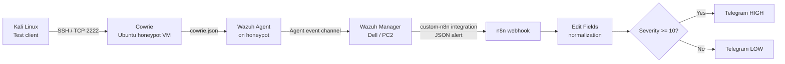
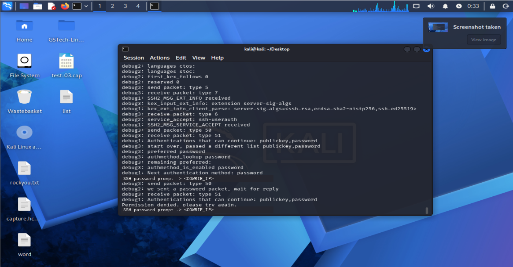
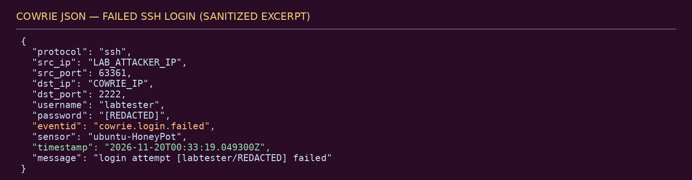
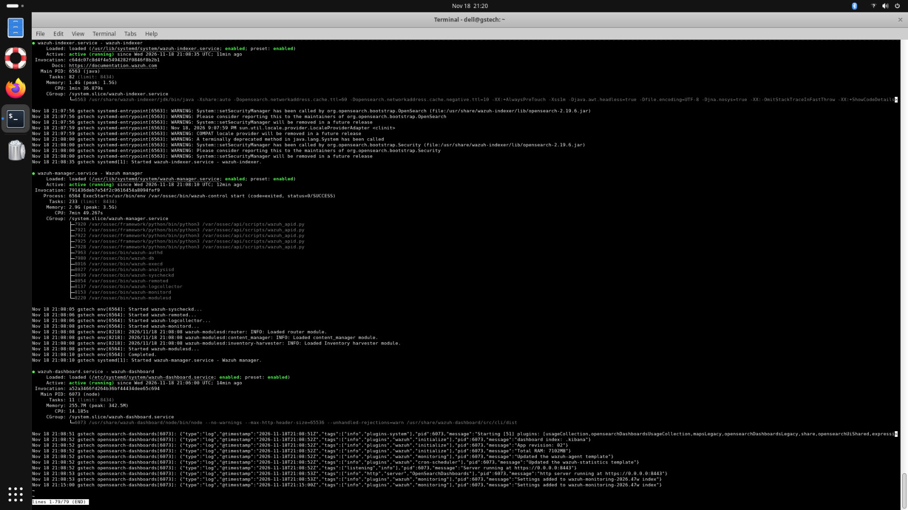
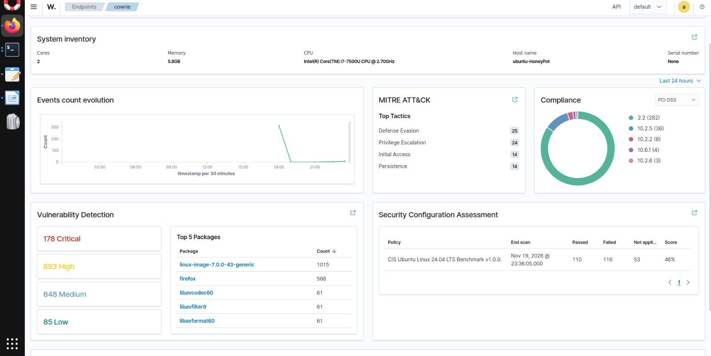
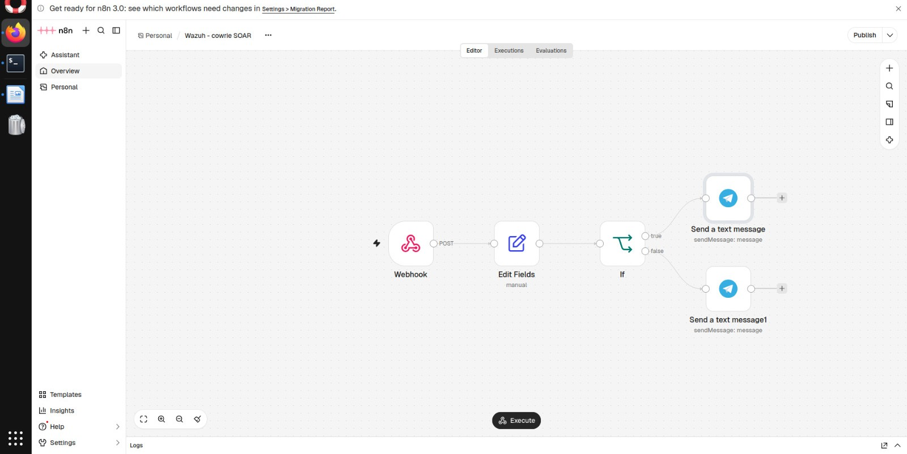
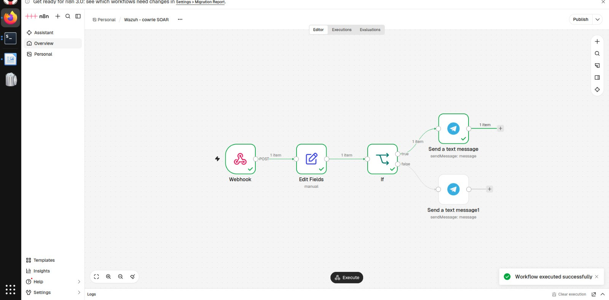
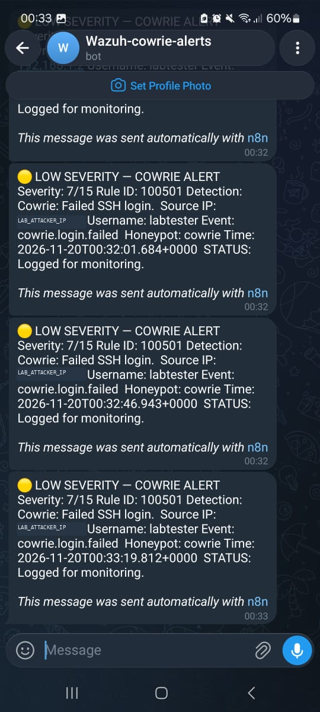
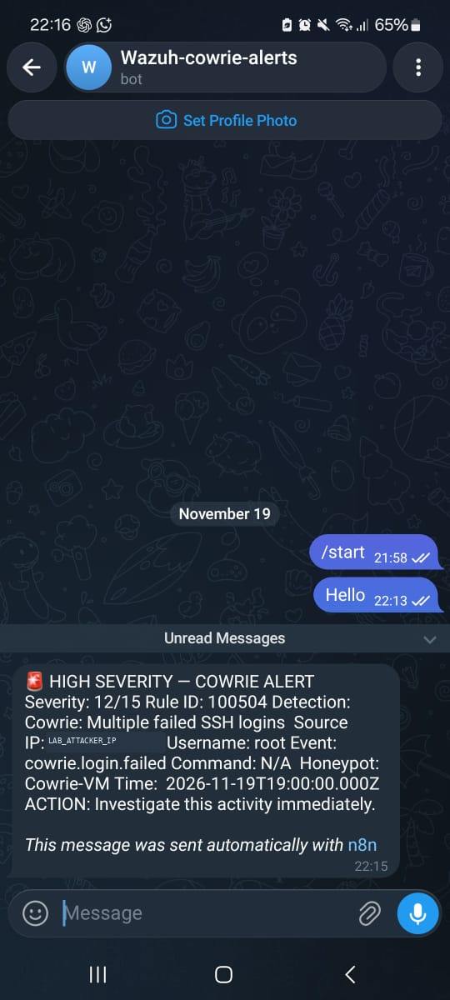

# Cowrie + Wazuh + n8n — SSH Honeypot Detection & SOAR Automation

A working, multi-machine cybersecurity home lab demonstrating how suspicious SSH activity can be captured by a honeypot, analysed by a SIEM, and forwarded through a SOAR-style workflow to an analyst's Telegram channel.

**Project status: implemented and tested in a private lab.** The supplied evidence includes a real Cowrie failed-login event, the corresponding Wazuh rule notification delivered to Telegram, the Wazuh Cowrie endpoint, the n8n conditional workflow, and HIGH-severity repeated-login notification evidence.

> Educational lab only. All attack simulations were performed against the author's own honeypot in a controlled network. The workflow sends notifications; it does not automatically block addresses or modify the host.

**Contents:** [At a glance](#at-a-glance) · [Architecture](#architecture) · [Detection pipeline](#how-the-detection-pipeline-works) · [Detection rules](#custom-wazuh-detection-rules) · [Evidence](#evidence-gallery) · [MITRE ATT&CK](#mitre-attck-behaviour-mapping) · [Case study](#soc-incident-case-study) · [Documentation](#documentation) · [Reproducing the lab](#reproducing-the-lab) · [Security](#security-and-repository-hygiene) · [Limitations](#scope-and-limitations)

## At a glance

| Area | Implementation |
|---|---|
| Honeypot | Cowrie SSH honeypot on Ubuntu, listening on TCP `2222` |
| Test source | Kali Linux VM using Nmap and SSH client tools |
| Log collection | Wazuh Agent monitors Cowrie's JSON event log |
| SIEM | Wazuh Manager, Indexer and Dashboard on a separate Ubuntu laptop |
| Detection | Custom Wazuh rules for failed/successful login, command input and repeated failures |
| SOAR workflow | Custom Python Wazuh integration → authenticated n8n webhook → severity routing |
| Notification | Telegram HIGH and LOW alert messages |

## Architecture



### Lab layout

| Machine | Components | Role |
|---|---|---|
| **PC1 — Windows laptop** | VMware Workstation | Hosts the virtual lab machines |
| **Kali VM** | Kali Linux, Nmap, OpenSSH client, `sshpass` | Generates controlled SSH and service-discovery activity |
| **Ubuntu VM** | Cowrie + Wazuh Agent | Emulates SSH, records events and forwards JSON telemetry |
| **PC2 — Dell laptop** | Ubuntu, Wazuh Manager / Indexer / Dashboard, n8n | Central monitoring, alert processing and notification |
| **Analyst device** | Telegram | Receives HIGH and LOW notifications |

All addresses in the screenshots and examples have been anonymized or replaced with placeholders. Use your own lab IP addresses in local configuration.

## How the detection pipeline works

1. Kali probes the Cowrie SSH service and performs controlled authentication tests.
2. Cowrie records the connection, client metadata, authentication result and session activity in `cowrie.json`.
3. The Wazuh Agent on the Cowrie VM monitors that JSON file and forwards events to the Manager on PC2.
4. Wazuh decodes the JSON and evaluates the custom Cowrie rules.
5. Alerts that meet the configured minimum level are passed to the `custom-n8n` Python integration.
6. The integration sends the alert JSON to the authenticated n8n production webhook using the `X-Wazuh-Token` header.
7. n8n normalizes fields and routes the alert using the severity threshold (`10`).
8. Telegram receives the corresponding HIGH or LOW message.

## Custom Wazuh detection rules

The repository includes the Cowrie rule set used in the lab. The repeated-failure rule correlates five failed logins from the same source IP within 60 seconds.

| Rule ID | Event / condition | Level | Meaning | n8n route |
|---|---|---:|---|---|
| `100501` | `cowrie.login.failed` | 7 | Failed SSH authentication | LOW |
| `100502` | `cowrie.login.success` | 10 | Successful login to the emulated SSH service | HIGH |
| `100503` | `cowrie.command.input` | 8 | Command entered in the honeypot session | LOW |
| `100504` | 5 failed logins from the same source in 60 seconds | 12 | Repeated-login / brute-force threshold | HIGH |

The Manager integration forwards alerts at level 7 and above (`<level>7</level>`), so all four rules reach n8n. The n8n workflow uses `severity >= 10` for its HIGH route. Wazuh levels run from 0 to 15, which is why Telegram shows values such as `12/15`. The threshold is configurable and should be aligned with the environment's severity policy.

Alert message fields and templates are documented in [`n8n/README.md`](n8n/README.md).

## Evidence gallery

The screenshots below were selected from the supplied lab capture archive. Sensitive local addresses and an attempted password were masked for public display.

### 1. Kali — SSH authentication test

Kali reaches the Cowrie endpoint and receives an authentication rejection from the emulated SSH service.



### 2. Cowrie — JSON authentication event

The Cowrie JSON log records an SSH `cowrie.login.failed` event, including the event timestamp and honeypot sensor name.



### 3. Wazuh — Manager services

The Wazuh Indexer, Manager and Dashboard services are shown running on the Dell / PC2.



### 4. Wazuh — Cowrie endpoint visibility

The Cowrie Ubuntu endpoint is visible in Wazuh with host inventory, event activity and the platform's MITRE ATT&CK and security monitoring views.



### 5. n8n — Conditional alert workflow

The webhook and field-normalization nodes feed an IF condition, which separates HIGH and LOW messages into two Telegram nodes.



### 6. n8n — Successful workflow execution

The execution view shows the webhook, field processing, IF node and the selected Telegram branch completing successfully.



### 7. Telegram — Real Cowrie failed-login notifications

Telegram receives LOW-severity messages for Cowrie failed-login events under Wazuh rule `100501`. The source and event time are consistent with the Cowrie JSON evidence above.



### 8. Telegram — HIGH-severity repeated-login alert

A repeated failed-login alert under Wazuh rule `100504` is routed to the HIGH-severity Telegram message format.



## MITRE ATT&CK behaviour mapping

The lab's simulated actions can be described using the following ATT&CK techniques. This is an analyst-oriented mapping of observed behaviours; it should not be interpreted as a claim that every technique is independently detected by a dedicated Wazuh rule.

| Observed behaviour | ATT&CK technique | Relevant telemetry |
|---|---|---|
| Nmap service discovery against TCP `2222` | [T1046 — Network Service Discovery](https://attack.mitre.org/techniques/T1046/) | Kali scan output / honeypot connection activity |
| SSH password guessing | [T1110.001 — Password Guessing](https://attack.mitre.org/techniques/T1110/001/) | `cowrie.login.failed`, rules `100501` and `100504` |
| SSH session to the emulated host | [T1021.004 — SSH](https://attack.mitre.org/techniques/T1021/004/) | Cowrie SSH session and login events |
| Shell commands entered in an authenticated session | [T1059.004 — Unix Shell](https://attack.mitre.org/techniques/T1059/004/) | `cowrie.command.input`, rule `100503` |

See [`docs/mitre-attack-mapping.md`](docs/mitre-attack-mapping.md) for notes and scope.

## SOC incident case study

A concise investigation walkthrough based on the failed-login and repeated-login alerts is available in [`docs/incident-case-study.md`](docs/incident-case-study.md). It covers the alert context, a timeline of the observed alerts, evidence, severity interpretation, a triage playbook with `jq` queries, response recommendations and detection gaps.

## Documentation

| Document | Use it to |
|---|---|
| [`docs/setup-guide.md`](docs/setup-guide.md) | Rebuild the pipeline step by step, with a verification check at each stage |
| [`docs/troubleshooting.md`](docs/troubleshooting.md) | Find the failing stage when an alert does not arrive |
| [`n8n/README.md`](n8n/README.md) | Configure the workflow: webhook, field mapping, severity IF, Telegram templates, curl test |
| [`docs/incident-case-study.md`](docs/incident-case-study.md) | See the investigation walkthrough, timeline and triage playbook |
| [`docs/mitre-attack-mapping.md`](docs/mitre-attack-mapping.md) | See how the simulated behaviours map to ATT&CK, and which have a rule |
| [`docs/GITHUB_PUSH_CHECKLIST.md`](docs/GITHUB_PUSH_CHECKLIST.md) | Check the repository for secrets and private data before publishing |

## Repository contents

```text
.
├── README.md
├── .gitignore
├── config/
│   ├── cowrie-agent-localfile.xml      # Agent: collect cowrie.json
│   ├── local_rules.xml                 # Manager: rules 100501-100504
│   └── manager-integration.xml.example # Manager: custom-n8n integration block
├── integrations/
│   └── custom-n8n.py                   # Forwards a Wazuh alert to the n8n webhook
├── n8n/
│   └── README.md                       # Workflow configuration and tests
├── samples/
│   ├── cowrie-login-failed.example.json  # Raw Cowrie event (for wazuh-logtest)
│   └── wazuh-alert-100504.example.json   # Wazuh alert (for testing the integration and n8n)
├── docs/
│   ├── setup-guide.md
│   ├── troubleshooting.md
│   ├── incident-case-study.md
│   ├── mitre-attack-mapping.md
│   └── GITHUB_PUSH_CHECKLIST.md
└── screenshots/
    └── selected, sanitized project evidence
```

## Reproducing the lab

This repository contains configuration examples and the integration script, not a full VM image or machine-specific backup. The full runbook, with a verification check after every step, is in [`docs/setup-guide.md`](docs/setup-guide.md). In outline:

1. Create an isolated lab network. Do not expose Cowrie, the Wazuh Dashboard or the n8n webhook to the public Internet.
2. Install Cowrie on the Ubuntu honeypot and confirm that `cowrie.json` is being written.
3. Install and enrol the Wazuh Agent on the same VM and confirm that it is **Active** in the Manager.
4. Add the `localfile` snippet from `config/cowrie-agent-localfile.xml` to the Agent's `ossec.conf` and restart the Agent.
5. Merge `config/local_rules.xml` into the Manager's local rules. Check with `wazuh-analysisd -t` and test each event with `wazuh-logtest` using the files in `samples/`.
6. Install `integrations/custom-n8n.py` on the Manager as `/var/ossec/integrations/custom-n8n` (owner `root:wazuh`, mode `750`).
7. Merge `config/manager-integration.xml.example` into the Manager's `ossec.conf`, using a newly generated random token that matches the n8n Header Auth credential.
8. Build the n8n workflow from [`n8n/README.md`](n8n/README.md), publish it, and use the production webhook URL in the integration.
9. Generate controlled SSH activity from Kali and follow one event through Cowrie, Wazuh, n8n and Telegram.

If an alert does not arrive, work through [`docs/troubleshooting.md`](docs/troubleshooting.md).

### Useful validation commands

**Kali:**

```bash
nmap -sV -p 2222 <COWRIE_LAB_IP>
ssh -vvv -p 2222 <HONEYPOT_USER>@<COWRIE_LAB_IP>
```

**Ubuntu honeypot:**

```bash
sudo systemctl status wazuh-agent --no-pager
tail -f /home/cowrie/my-honeypot/var/log/cowrie/cowrie.json
```

**Wazuh Manager (Dell / PC2):**

```bash
sudo /var/ossec/bin/agent_control -l
sudo tail -f /var/ossec/logs/alerts/alerts.json
sudo tail -f /var/ossec/logs/ossec.log
sudo tail -f /var/ossec/logs/integrations.log
```

**n8n:** inspect the Executions page and verify the expected IF branch and Telegram node.

## Security and repository hygiene

Never commit:

- `.env` files, passwords, API keys, webhook tokens, Telegram bot tokens or chat IDs;
- Cowrie `userdb.txt`, real `cowrie.json` logs, password lists or unredacted attacker data;
- Wazuh `client.keys`, API credentials, live `ossec.conf`, indexes, databases, queues or logs;
- n8n database files, `.n8n/` data, credential stores, encryption keys or unsanitized workflow exports;
- private SSH/TLS keys, certificates containing private keys, VM disks, snapshots or personal packet captures.

The `X-Wazuh-Token` must be a fresh secret stored only in the local n8n credential and Wazuh Manager configuration. Do not hard-code it in the Python script or Git repository.

The Manager passes the token to the integration script as a command-line argument, so keep local access to that host restricted (see the [setup guide](docs/setup-guide.md#operational-notes)).

Before making the repository public, follow [`docs/GITHUB_PUSH_CHECKLIST.md`](docs/GITHUB_PUSH_CHECKLIST.md) and inspect every file and screenshot.

## Scope and limitations

- Cowrie is an SSH honeypot emulator, not a production SSH server and not evidence of compromise of a real endpoint.
- The response workflow is notification and triage oriented; it does not automatically block source IPs or execute host remediation.
- Detection coverage is limited to the Cowrie events and rules configured in this lab.
- The project is designed for controlled learning and demonstration, not as a turnkey production SOC deployment.

## Skills demonstrated

Linux administration · virtual networking · SSH service testing · honeypot deployment · JSON log analysis · Wazuh agent/manager administration · custom SIEM rules · event correlation · Python integrations · REST webhooks · n8n workflow automation · Telegram alerting · MITRE ATT&CK mapping · incident documentation.

---

**Author:** Latifi Adam 
**Project type:** Personal cybersecurity lab / SOC portfolio project
